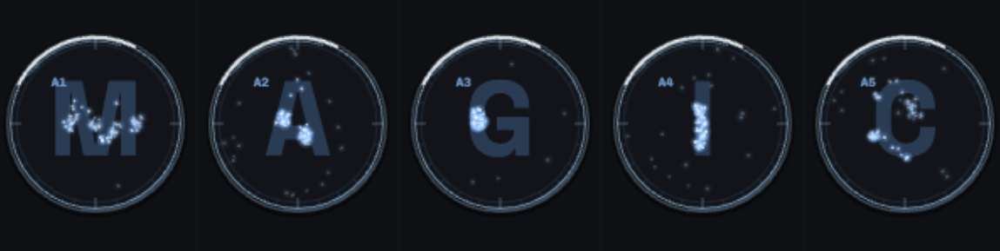
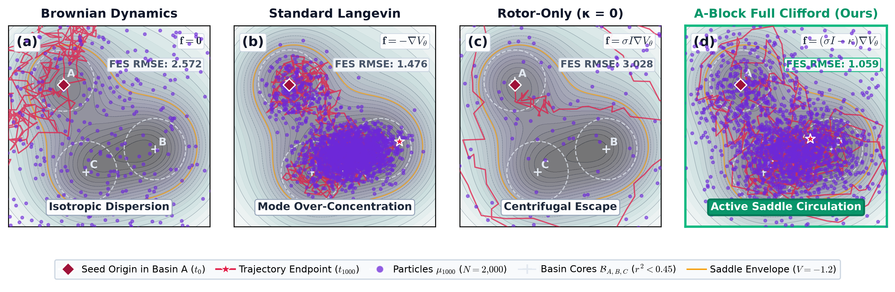
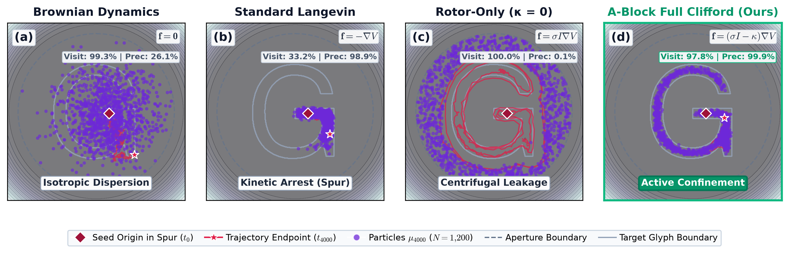

# A-Block: Clifford Score Dynamics

[](paper/main.pdf)
[](https://openreview.net/forum?id=t1UaaGEPJB)
[](https://pytorch.org/)
[](https://creativecommons.org/licenses/by/4.0/)

Official implementation for **"A-Block: Clifford Score Dynamics"** by **Erick Oduniyi**, presented at the *Machine Learning and the Physical Sciences (ML4PS) Workshop at NeurIPS*.

<p align="center">
  
</p>

---

## Overview

**A-Block** (Algebraic Block) unifies 2D Clifford Geometric Algebra $\text{Cl}(2,0)$, score-based stochastic differential equations, and active matter hydrodynamics. By coupling a Denoising Score Matching (DSM) potential $V_\theta(\mathbf{x})$ with a multivector rotor-dilator operator:

$$
\mathbf{f}_i(\mathbf{x}_i) = (\sigma_i I - \kappa_i) \nabla V_\theta(\mathbf{x}_i), \qquad I = e_1 e_2 \; (I^2 = -1)
$$

particles circulate tangentially along equipotential contours ($\sigma I \nabla V_\theta$) while the dilator contracts along the potential gradient ($-\kappa \nabla V_\theta$). The current implementation is a finite-time sampler on a synthetic 2D landscape; it does not establish exact equilibrium sampling or molecular performance.
1. **Synthetic Multi-Well Benchmark:** Compares finite-time FES reconstruction, distribution distance, basin occupancy, visitation, and transitions against Langevin and component ablations (Figure 1, Table 1).
2. **Finite-Horizon Form Coverage:** Compares particle visitation and terminal coverage in a synthetic non-convex glyph potential (Figure 3); this benchmark does not establish a steady state.

For independently updated particles, both A-Block and standard Langevin require $O(N)$ field evaluations per step; A-Block adds rotor-dilator arithmetic. This repository does not report a scaling crossover or a wall-clock efficiency advantage.

---

## Quickstart

```bash
git clone https://github.com/eoduniyi/ablock.git
cd ablock
pip install -r requirements.txt
pip install -e .
```

### Reproducing Paper Figures & Benchmarks

The seeded benchmark scripts regenerate the metrics and figures. Runtime varies by hardware and is not used as a comparative result.

```bash
# 1. Multi-well benchmark, ablations, timestep sensitivity & Figure 1
python3 reproduce_table1_and_figure1.py

# 2. Non-convex typography navigation & Figure 3
python3 reproduce_typography_figure3.py

# 3. Unit tests
pytest tests/ -v
```

---

## Benchmark Summary

### Synthetic Multi-Well Dynamics (Table 1 & Figure 1)

<p align="center">
  
</p>

| Method | FES RMSE (kcal/mol) $\downarrow$ | $\mathcal{W}_1$ Distance $\downarrow$ | Terminal B/C occupancy (%) | Cumulative B/C visitation (%) | Transitions / Pt. |
| :--- | :---: | :---: | :---: | :---: | :---: |
| **Brownian Dynamics** ($\mathbf{f} = \mathbf{0}$) | 2.572 ± 0.136 | 3.127 ± 0.035 | 2.0 ± 0.4% | 56.4 ± 1.0% | 1.74 ± 0.06 |
| **Standard Langevin** ($\kappa = 1, \sigma = 0$) | 1.476 ± 0.069 | **0.066 ± 0.008** | **60.9 ± 1.6%** | **99.7 ± 0.1%** | 21.47 ± 0.13 |
| **Dilator-Only Ablation** ($\sigma = 0, \kappa$) | 1.064 ± 0.044 | 0.266 ± 0.026 | 44.2 ± 1.5% | 96.9 ± 0.3% | 13.86 ± 0.15 |
| **A-Block Rotor-Only** ($\kappa = 0, \sigma$) | 3.028 ± 0.194 | 4.243 ± 0.017 | 0.4 ± 0.2% | 70.1 ± 0.8% | 2.82 ± 0.04 |
| **A-Block Full Clifford (Ours)** | **1.059 ± 0.031** | 0.385 ± 0.016 | 37.4 ± 0.7% | **99.7 ± 0.1%** | **22.48 ± 0.15** |

These are finite-time results on a synthetic potential. The Boltzmann reference places 63.6% of its mass in basins B/C, so the standard Langevin terminal occupancy is closer to that reference than A-Block's. The lower A-Block FES RMSE is restricted to the stated low-energy mask and should be read alongside the distribution and occupancy metrics, not as evidence of overall equilibrium superiority.

### Non-Convex Typography Navigation (`'G'`, Figure 3)

<p align="center">
  
</p>

| Method | In-Glyph Precision (%) $\uparrow$ | Trajectory Visitation (%) $\uparrow$ | Terminal Coverage (%) $\uparrow$ |
| :--- | :---: | :---: | :---: |
| **Brownian Dynamics** ($\mathbf{f} = \mathbf{0}$) | 26.1% | 99.3% | 90.5% |
| **Standard Langevin** ($\sigma = 0, \kappa = 1.0$) | 98.9% | 33.2% | 33.7% |
| **Rotor-Only** ($\sigma = 11.0, \kappa = 0$) | 0.1% | 100.0% | 1.4% |
| **A-Block Full Clifford (Ours)** | **99.9%** | **97.8%** | **99.2%** |

---

## Repository Contents

- `src/` — Core `Cl(2,0)` neural score network (`models.py`), potentials (`potentials.py`), DSM trainer (`training.py`), SDE integrators (`samplers.py`), and evaluation metrics (`metrics.py`).
- [`notebooks/00_ablock_guided_tour_and_sketches.ipynb`](notebooks/00_ablock_guided_tour_and_sketches.ipynb) — **Start Here:** Self-contained intuition builder with 5 minimal Python sketches, pre-rendered visual outputs, and a guided map to the codebase (`01` and `02` provide focused benchmark notebooks).
- `interactive/` — Browser-based `p5.js` sketches for the multi-aperture `"MAGIC"` ensemble (`magic_apertures/`) and a conceptual all-pairs-graph vs. independent-field operation-count illustration (`proposition1_visualizer/`). The $O(N)$ field-evaluation cost applies to both A-Block and standard Langevin in this benchmark.
- `paper/` — LaTeX source (`main.tex`) and compiled manuscript (`main.pdf`).
- [`reproducibility.md`](reproducibility.md) & [`provenance.md`](provenance.md) — Mathematical derivations, Fokker–Planck stationarity analysis, and parameter provenance.

---

## Citation

```bibtex
@inproceedings{oduniyi2026ablock,
  title={A-Block: Clifford Score Dynamics},
  author={Oduniyi, Erick},
  booktitle={Machine Learning and the Physical Sciences (ML4PS) Workshop at NeurIPS},
  year={2026},
  url={https://openreview.net/forum?id=t1UaaGEPJB}
}
```

## License
Licensed under [CC BY 4.0](https://creativecommons.org/licenses/by/4.0/).
